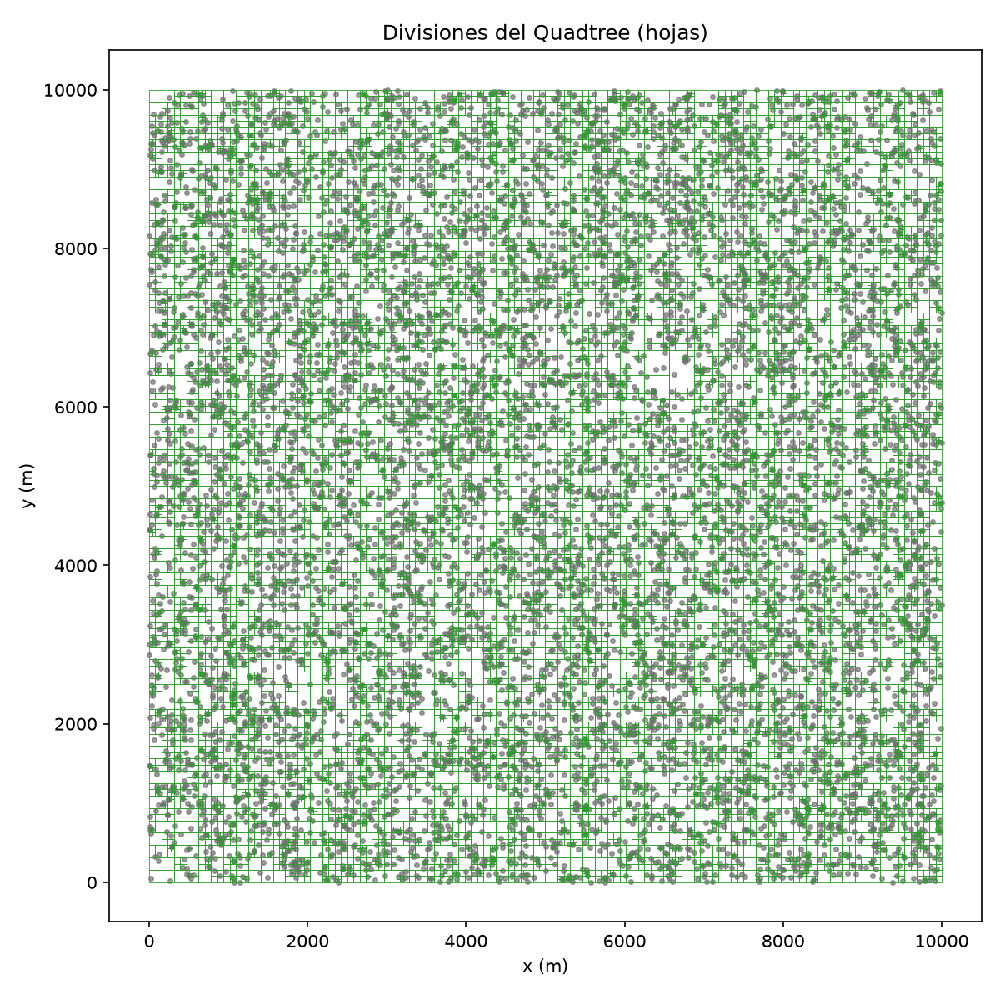
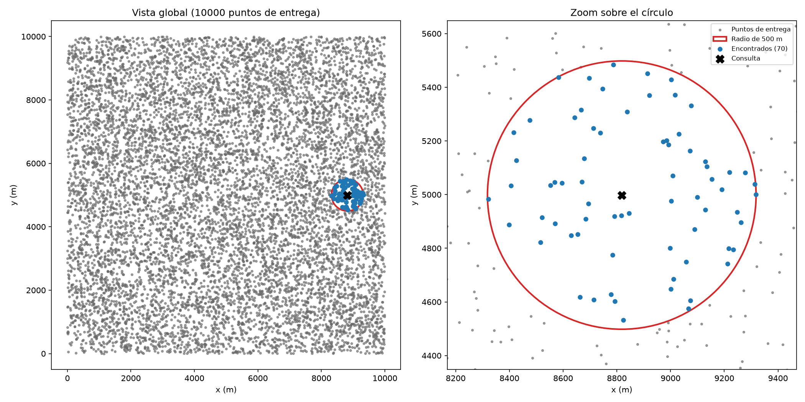
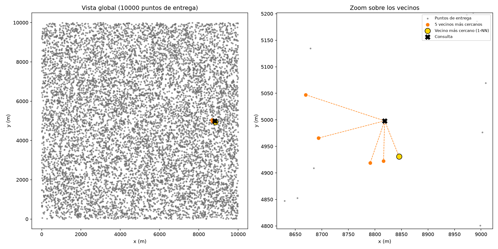
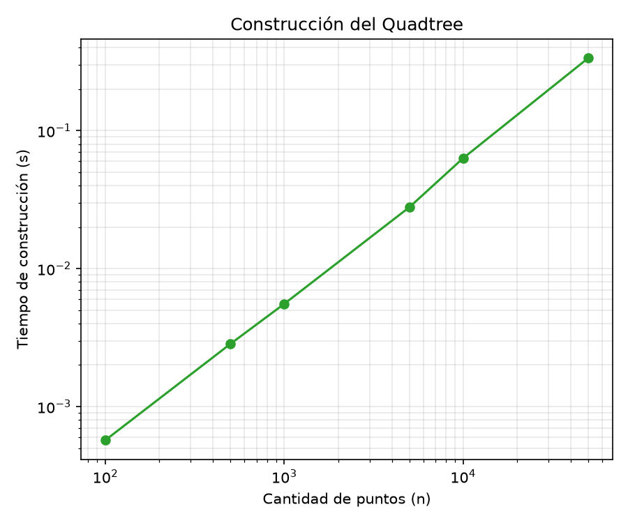
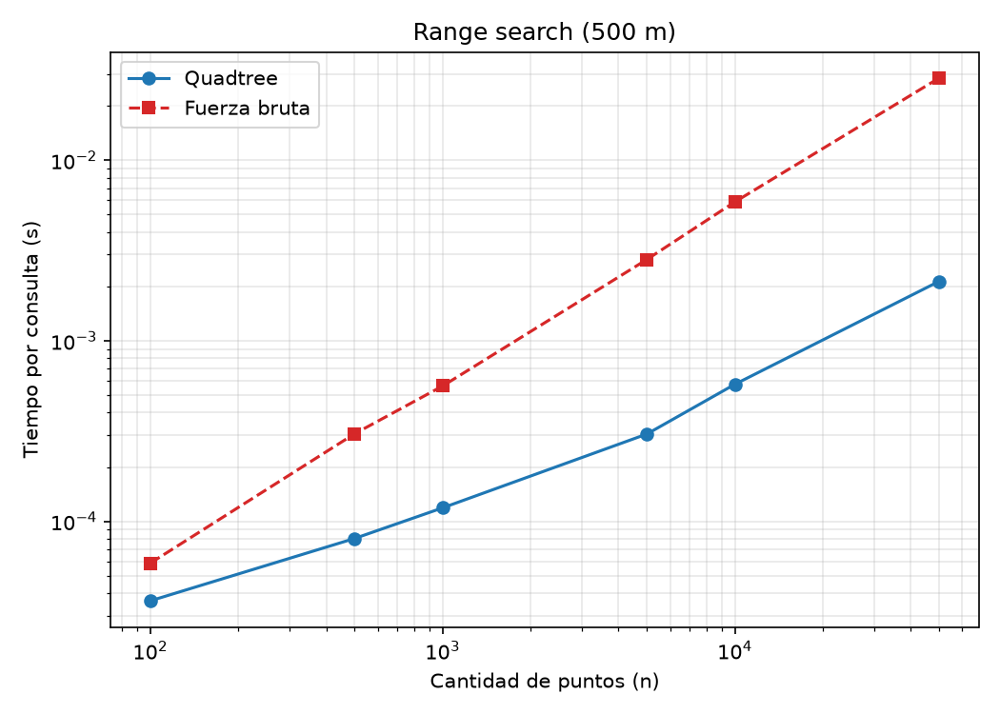
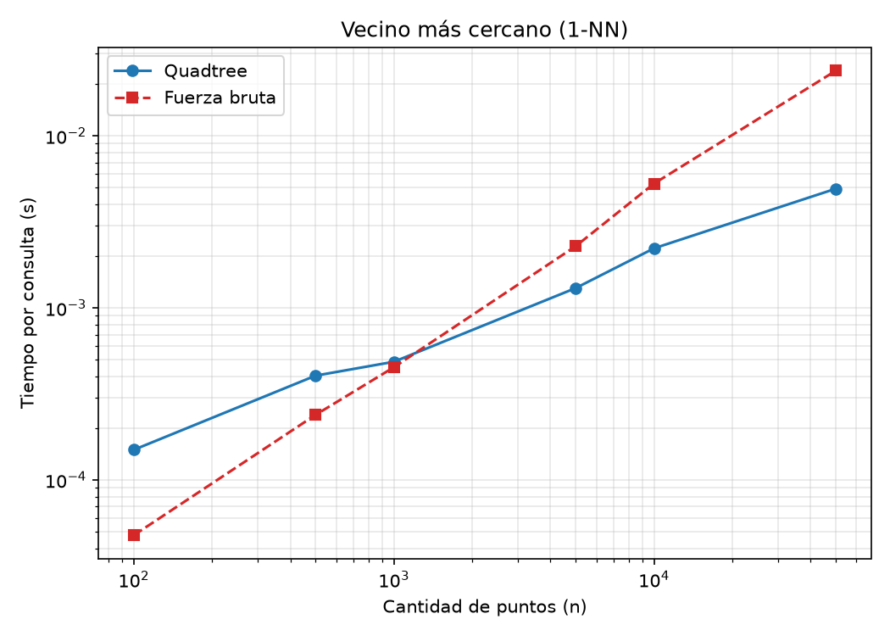
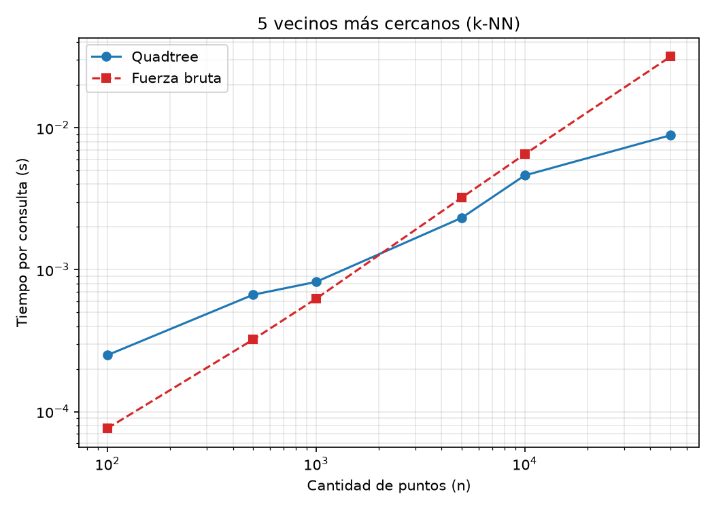

# Laboratorio 4: búsqueda espacial con un PR Quadtree

**Estudiante:** Daniel Sánchez Escobar

## Introducción

En este laboratorio se implementa desde cero un árbol **PR (Punto-Región) Quadtree** para
organizar puntos de entrega en dos dimensiones. El objetivo es consultar puntos
cercanos de forma eficiente y comparar las consultas del árbol con una
implementación de fuerza bruta basada en listas.

### Enunciado

Como parte de un equipo que desarrolla un sistema de logística de entregas en
una ciudad, se dispone de las coordenadas $(x,y)$ de 10000 puntos de entrega.
Para este ejercicio, los datos son estáticos y se generan de forma reproducible.
El sistema debe responder preguntas como:

- ¿Qué puntos de entrega están a un radio de 500 metros de una ubicación?
- ¿Cuál es el punto de entrega más cercano a una ubicación dada?

El objetivo es construir un Quadtree sin utilizar árboles ya implementados ni
librerías como SciPy, implementar búsquedas por rango y de vecinos cercanos,
comparar su comportamiento con fuerza bruta y verificar los resultados mediante
pruebas y visualizaciones.

## Descripción y decisiones de diseño

- **Estructura:** se utiliza un **PR Quadtree** de dos dimensiones. Cada nodo
  interno divide su región en cuatro cuadrantes. Solo las hojas almacenan puntos.
- **Capacidad:** cada hoja admite por defecto `capacity=1` punto. También se
  prueban capacidades de 4 y 8. No obstante, se indica la capacidad 
  en caso de que esta se modifique en alguna prueba o test de rendimiento.
- **Coordenadas y unidades:** las coordenadas son representadas mediante tuplas de Python $(x,y)$, están expresadas
  en metros y están contenidas en una ciudad cuadrada de 10000 m por 10000 m (10x10 kilómetros). Las distancias se calculan 
  con la distancia euclidiana cuadrada, con el fin de evitar el cálculo de raíces en los algoritmos.
- **Convención de bordes y distribución:** cada región cuadrada se divide por
  sus coordenadas medias. Si sus límites son $[x_{\min},x_{\max}]\times[y_{\min},y_{\max}]$, las líneas de división son
    $$
    x_{\mathrm{mid}}=\frac{x_{\min}+x_{\max}}{2},
    \qquad
    y_{\mathrm{mid}}=\frac{y_{\min}+y_{\max}}{2}.
    $$
  Cada punto $(x,y)$ se asigna según estas reglas:

    $$
    \begin{aligned}
    \text{NE} &: x>x_{\mathrm{mid}} \quad \text{y} \quad y>y_{\mathrm{mid}},\\
    \text{NW} &: x\leq x_{\mathrm{mid}} \quad \text{y} \quad y>y_{\mathrm{mid}},\\
    \text{SW} &: x\leq x_{\mathrm{mid}} \quad \text{y} \quad y\leq y_{\mathrm{mid}},\\
    \text{SE} &: x>x_{\mathrm{mid}} \quad \text{y} \quad y\leq y_{\mathrm{mid}}.\\
    \end{aligned}
    $$

  Los cuadrantes se nombran según la convención de puntos cardinales:
  **NE** (noreste), **NW** (noroeste), **SW** (suroeste) y **SE** (sureste).
  Así, los puntos sobre una línea media quedan asignados sin ambigüedad:
  la igualdad se resuelve hacia el oeste para $(x)$ y hacia el sur para $(y)$.
  Esta convención previene solapamientos o pérdida de puntos en las fronteras.
  Esta regla de subdivisión y distribución está basada en *Computational
  Geometry: Algorithms and Applications*, de Mark de Berg, Otfried Cheong,
  Marc van Kreveld y Mark Overmars.

- **Profundidad máxima:** se establece `max_depth=20` para detener subdivisiones
  en regiones con puntos repetidos. Al partir de una región
  de 10000 m por lado, el lado de una celda tras 20 divisiones es
  $10000 / 2^{20} \approx 0,00954\text{ m}$, es decir, menos de 1 cm. Esta restricción 
  detiene la subdivisión en casos extremos donde existan puntos idénticos o 
  extremadamente cercanos, evitando llamadas recursivas infinitas o desbordamiento de pila.
- **Consulta sobre un punto existente:** si el punto de consulta coincide 
    exactamente con las coordenadas de un punto almacenado en la estructura, 
    la búsqueda del vecino más cercano ($1\text{-NN}$) retorna dicho punto con una distancia calculada de 0 m.
- **Búsqueda por radio:** en las búsquedas por rango, un punto se considera dentro de 
    la región circular si su distancia euclidiana al centro de consulta es 
    menor o igual al radio definido ($d \le r$).

## Cómo ejecutar

Se requiere **Python 3.10 o superior** y las dependencias `matplotlib` y
`pandas`. Desde la carpeta `lab_04`, instala las dependencias y ejecuta las
pruebas:

```bash
python -m pip install matplotlib pandas
python test.py
```

`test.py` ejecuta las pruebas unitarias, genera el reporte
`analisis_pruebas.txt` y crea en `imagenes/` las visualizaciones
`nearest_neighbors.png`, `quadtree_divisions.png` y `range_search.png`.

Para ejecutar además el análisis de rendimiento comparativo entre Quadtree y
fuerza bruta:

```bash
python analisis.py
```

Este análisis verifica primero que ambos algoritmos produzcan resultados
equivalentes; luego mide consultas y construcción para distintos tamaños de
entrada. Genera el reporte `analisis_rendimiento.txt` y las gráficas
`analisis_construccion.png`, `analisis_knn.png`, `analisis_nn.png` y
`analisis_range.png` en `imagenes/`.

## Estructura de la carpeta

```text
lab_04/
├── README.md
├── Quadtree.py
├── test.py
├── analisis.py
├── analisis_pruebas.txt
├── analisis_rendimiento.txt
└── imagenes/
    ├── analisis_construccion.png
    ├── analisis_knn.png
    ├── analisis_nn.png
    ├── analisis_range.png
    ├── nearest_neighbors.png
    ├── quadtree_divisions.png
    └── range_search.png
```

- `Quadtree.py`: implementación del PR Quadtree y de las operaciones de
  búsqueda espacial.
- `test.py`: pruebas unitarias, comparación con fuerza bruta y generación del
  reporte y las visualizaciones de las pruebas.
- `analisis.py`: verificación de resultados y análisis comparativo del
  rendimiento del Quadtree frente a fuerza bruta.
- `analisis_pruebas.txt`: reporte generado al ejecutar `test.py`.
- `analisis_rendimiento.txt`: reporte generado al ejecutar `analisis.py`.
- `imagenes/`: gráficos de las pruebas y del análisis de rendimiento.

## Pruebas unitarias, generación de visualizaciones y reporte de resultados

En esta sección se detalla el funcionamiento del archivo `test.py`, el cual evalúa pruebas de correctitud (buen funcionamiento)
de la estructura de datos y pruebas de visualización del funcionamiento del árbol en sí:

1. Las pruebas unitarias se realizan en la clase `TestQuadtree` usando `unittest`. Son aserciones formales de corrección algorítmica. Verifican que los métodos del quadtree coincidan con los resultados de fuerza bruta, que se comporten de manera consistente ante casos límite (ejemplo: puntos en los bordes de range search, puntos duplicados, etc.), que se contengan de forma íntegra todos los puntos de entrada, entre otros. Se ejecutan utilizando diversas capacidades de puntos por hoja.
2. La visualización y generación del reporte/tablas son responsabilidad de `Plotter` y `TestReport`. No son pruebas unitarias de paso/fallo. El objetivo de estas clases es visualizar el funcionamiento del árbol a nivel general (ejecución demostrativa). En esta fase se construye un único árbol con capacity = 1 (un punto por hoja) y max_depth = 20 (profundidad máxima) sobre el conjunto estático de 10000 puntos, recopilando métricas sobre la profundidad real del árbol, estadísticas en búsquedas por rango, resultados de los algoritmos de vecinos más cercanos y la generación de los archivos de imagen PNG.


### Parámetros utilizados
Para evaluar el buen funcionamiento del sistema se configuró un entorno con los siguientes parámetros:

| Parámetro                 | Valor                            | Justificación                                                                                                              |
| ------------------------- | -------------------------------- | -------------------------------------------------------------------------------------------------------------------------- |
| Cantidad de puntos        | $N = 10000$                     | Utiliza el número de puntos definidos por el enunciado.                                                        |
| Dimensiones de la ciudad  | $10000 \times 10000$ metros | Representa un área urbana de $100\text{km}^2$.                                                                                 |
| Semilla de aleatorización | `SEED = 42`                      | Garantiza que la generación de coordenadas sintéticas sea reproducible en cada ejecución.                                  |
| Radio de búsqueda         | `RADIUS = 500 m`                 | Radio estándar definido por el enunciado para consultas de rango (Range search).                                                      |
| Número de consultas       | `NUM_QUERIES = 200`              | Cantidad de puntos de consulta aleatorios evaluados en las pruebas. |
| Capacidades probadas      | `CAPACITIES = (1, 4, 8)`         | Permite verificar que los algoritmos funcionen de forma idéntica con distintas capacidades de puntos por nodo hoja.        |

> **Nota:** se puede observar que en el archivo `test.py` se encuentra la clase `BruteForceAlgorithm`, esta clase agrupa las implementaciones de la búsqueda por radio (Range Search), búsqueda del vecino más cercano (1-NN) y búsqueda de los k vecinos más cercanos (k-NN) a través de listas nativas de Python. Por lo tanto, estas implementaciones corresponden a la versión de **fuerza bruta** de cada algoritmo y serán utilizadas a lo largo de las pruebas de corrección y de rendimiento como puntos de comparación frente al árbol quadtree.


### Descripción de cada prueba unitaria

`TestQuadtree` implementa seis métodos de prueba específicos:

| Método de prueba                                                                           | ¿Qué hace?                                                                                                                                                                             | Propósito                                                                                                                                                                                                                                                                             |
| ------------------------------------------------------------------------------------------ | -------------------------------------------------------------------------------------------------------------------------------------------------------------------------------------- | ------------------------------------------------------------------------------------------------------------------------------------------------------------------------------------------------------------------------------------------------------------------------------------- |
| `test_build_keeps_all_points` (Integridad de construcción)                                 | Construye el árbol con la capacidad por defecto (`capacity = 1`) y recorre recursivamente sus hojas mediante `collect_leaf_points`.                                                    | Compara los puntos recolectados con los $10000$ originales usando `assertEqual` para verificar la cantidad y `assertCountEqual` para comprobar que sean exactamente los mismos, sin importar el orden. Garantiza que ningún punto se pierda o se duplique durante las subdivisiones. |
| `test_range_search_matches_brute_force` (Equivalencia en búsqueda por rango)               | Construye árboles independientes para cada capacidad de `CAPACITIES = (1, 4, 8)` y ejecuta $200$ consultas aleatorias por árbol, con un radio de $500\text{m}$.                           | Compara los resultados de `tree.range_search` con los de `BruteForceAlgorithm.range_search`. Realiza $600$ comparaciones exactas para verificar que la poda de ramas no omita puntos que cumplen o incluya puntos que no cumplen.                                                                         |
| `test_nearest_neighbor_matches_brute_force` (Equivalencia en vecino más cercano) | Evalúa árboles con capacidades `CAPACITIES = (1, 4, 8)` mediante $200$ consultas aleatorias por capacidad. También consulta un punto existente del conjunto (`self.points[0]`).                  | Compara las distancias euclidianas al cuadrado obtenidas por Quadtree y fuerza bruta y verifica que la distancia encontrada por ambos algoritmos sea la misma. Comprueba además que consultar un punto existente produzca distancia $0$ y retorne dicho punto.                              |
| `test_range_search_circle_border` (Prueba sintética de bordes de circunferencia)           | Construye un conjunto controlado con los puntos $(0,0)$, $(500,0)$, $(300,400)$, $(500.001,0)$, $(0,501)$ y $(5000,5000)$, respecto a una consulta en $(0,0)$ con radio de $500\text{m}$. Lo hace para cada capacidad `CAPACITIES = (1, 4, 8)`. | Verifica, para todas las capacidades, que la condición $d\leq r$ incluya los puntos situados exactamente sobre la circunferencia y excluya los que están fuera del radio. Incluye un punto lejano ubicado sobre la línea de corte central del árbol.                                  |
| `test_duplicated_and_no_results` (Casos límite y detención por profundidad)                | Prueba dos escenarios: cinco copias del punto $(1000,1000)$ con `capacity = 1`, y una búsqueda por rango desde $(9000,9000)$ en una región sin puntos cercanos.                        | Comprueba que el árbol alcance una profundidad de `max_depth = 20` ante puntos duplicados (no falla por recursión infinita), que la búsqueda por rango encuentre las cinco copias y que una consulta sin resultados devuelva una lista vacía `[]` sin lanzar excepciones.                                                                      |
| `test_k_nearest_matches_brute_force` (Equivalencia en $k$ vecinos más cercanos)  | Evalúa búsquedas de $k=5$ vecinos en árboles con capacidades `CAPACITIES = (1, 4, 8)`, usando $200$ consultas aleatorias por capacidad. También prueba los casos $k\leq 0$ y $k>N$ (con los puntos $(1.0, 1.0), (2.0, 2.0), (3.0, 3.0)$).              | Compara las distancias al cuadrado, obtenidas por Quadtree con las del algoritmo de fuerza bruta `BruteForceAlgorithm.k_nearest_neighbor_search` para determinar si coinciden. También, verifica que $k\leq 0$ retorne `[]` y que $k>N$ devuelva todos los puntos disponibles.                                                      |

### Tablas de resultados y métricas

A continuación se presentan las cuatro tablas generadas tras la ejecución del módulo test.py

#### Tabla 1: Resumen de Pruebas Unitarias
Esta tabla sintetiza el resultado de la ejecución de las pruebas unitarias automatizadas (`TestQuadtree`).

| Indicador | Resultado |
|---|---:|
| Pruebas ejecutadas | 6 |
| Fallos | 0 |
| Errores | 0 |
| Estado | Todas pasaron |
| Capacidades probadas | 1, 4 y 8 |
| Comparaciones por prueba (pruebas 2, 3 y 6) | 200 consultas × 3 capacidades = 600 |

#### Tabla 2: Estructura del Árbol ($10000$ puntos, ciudad de $10000\text{m} \times 10000\text{m}$)

Se usa un árbol de capacidad de 1 punto por hoja.

| Capacidad | Profundidad | Número de hojas | Hojas vacías | Máximo de puntos por hoja | ¿`max_depth` cortó? |
|---:|---:|---:|---:|---:|---|
| 1 | 13 | 21631 | 11631 | 1 | No |

Respecto a los resultados, puede observarse que:

- El árbol alcanzó una profundidad máxima de 13 niveles (considerando la raíz como nivel 0) sin llegar al límite de 20 niveles establecido para evitar recursiones infinitas al subdividir. Dado que el lado de la región inicial es de 10000 metros y se reduce a la mitad en cada subdivisión, las celdas del nivel 13 tienen un lado aproximado de 1.22 metros. La profundidad está relacionada con la distancia entre los puntos y el tamaño del cuadrado inicial. Aunque no es posible expresar la profundidad en función del número neto de puntos almacenados.

- De las 21631 hojas del árbol, 11631 están vacías, lo que representa aproximadamente el 53.8% del total. Esta proporción no es necesariamente extraña, puesto que un PR Quadtree siempre divide una región cuadrada en cuatro cuadrados más pequeños, pero esto no implica que el conjunto de puntos también se divida, es decir, existen los casos donde todos los puntos terminen en un mismo cuadrante, dejando regiones vacías. Asimismo, la capacidad de un punto por hoja favorece la generación del mayor número de subdivisiones adicionales cuando varios puntos ocupan una misma región. En conjunto, estos resultados permiten describir la estructura obtenida y son consistentes con el comportamiento esperado del árbol, aunque por sí solos no permiten extraer conclusiones sobre su eficiencia o rendimiento.

A continuación, la siguiente imagen permite dar un vistazo a nivel macroscópico del resultado obtenido al construir todo el árbol:



#### Tabla 3: Búsquedas por rango ($200$ consultas aleatorias, $500\text{m}$, ciudad de $10000\text{m} \times 10000\text{m}$)

Consultas con radio de 500 m (200 consultas aleatorias). Se utiliza el mismo árbol con capacidad de 1 punto por hoja.

| Métrica | Resultado |
|---|---:|
| Promedio de puntos encontrados | 74.8 |
| Mínimo de puntos encontrados | 19 |
| Máximo de puntos encontrados | 113 |
| Consultas sin resultados | 0 |

- En las 200 consultas de búsqueda por rango, realizadas con un radio de 500 metros, se obtuvo un promedio de 74.8 puntos encontrados por consulta. El mínimo fue de 19 puntos y el máximo de 113, sin consultas que devolvieran resultados vacíos.
- Para contextualizar los resultados y debido a que se hace uso de la función `uniform` del módulo `random` para generar los puntos, es posible calcular la densidad de puntos teórica suponiendo que estos están uniformemente distribuidos en la ciudad (el cuadrado más grande):
    - La densidad promedio se calcula como la cantidad total de puntos dividida entre el área de generación, $\rho =\frac{N}{A}=\frac{10000}{100}=100\text{ puntos/km}^2$.
    - El área del círculo de consulta con radio de $500\text{m}$ es $A_c=\pi r^2=\pi(0.5)^2\approx0.7854\text{ km}^2$.
    - Al multiplicar el área por la densidad, obtenemos el número de puntos esperados que debería contener el círculo: $100\text{ puntos/km}^2 \times 0.7854 \text{ km}^2 \approx 78.54$ puntos.
    - El promedio observado de 74.8 puntos es aproximadamente 3.74 puntos inferior a esta estimación. En general, una posible explicación está en el hecho de que no necesariamente todos los puntos de consulta generan círculos contenidos por completo en la ciudad. Un punto cercano al borde (o en el borde) de la región principal va a producir que parte del círculo quede fuera del área con puntos. Por ejemplo, si un punto de consulta es exactamente una esquina del área de la ciudad, $3/4$ partes de él estarán completamente vacías, en consecuencia, estos casos producen menos resultados y disminuyen el valor del promedio calculado.

A continuación, la imagen presenta un ejemplo demostrativo de la búsqueda por rango, realizada sobre el mismo árbol de la imagen anterior, para el punto de consulta $(8818.4, 4998.1)\text{ m}$ con un radio de $500\text{m}$. El panel izquierdo es la vista global de la ciudad con la zona de búsqueda destacada y el panel derecho hace zoom sobre la circunferencia de radio $500\text{m}$. Los puntos azules corresponden exactamente a los $70$ encontrados dentro de la frontera roja, mientras que los puntos grises permanecen fuera del rango.



#### Tabla 4: Vecinos más cercanos (un solo punto de consulta, ciudad de $10000\text{m} \times 10000\text{m}$)

Valores numéricos obtenidos durante la ejecución demostrativa para el punto de consulta aleatorio seleccionado en las visualizaciones.
Se utiliza el mismo árbol con capacidad de 1 punto por hoja.

| Métrica | Resultado |
|---|---:|
| Consulta $(x, y)$ | $(8818.4, 4998.1)$ m |
| Distancia al vecino más cercano (1-NN) | 72.57 m |
| Distancia al vecino 5 (el más lejano de los 5) | 156.59 m |

Se ejecutó una consulta para encontrar los cinco puntos más cercanos a la coordenada $(8818.4, 4998.1)$. El vecino más cercano se encuentra a una distancia de 72.57 metros, mientras que el quinto vecino, correspondiente al más lejano de los cinco resultados seleccionados, se encuentra a 156.59 metros. Estos valores describen las distancias obtenidas para el punto de consulta seleccionado y permiten observar cómo la búsqueda identifica los puntos más próximos según su distancia espacial.

El vecino más cercano ($1\text{-NN}$) se destaca mediante un círculo dorado de mayor tamaño a $72.57\text{ m}$. Los $k=5$ vecinos más cercanos se muestran conectados con líneas punteadas naranjas hacia el punto de consulta.



## Análisis de rendimiento

### Objetivo

El análisis de rendimiento estudia, para distintos tamaños de entrada, el costo
temporal de las operaciones del Quadtree y lo compara con una implementación de
fuerza bruta basada en listas. En particular, busca responder las preguntas del
enunciado sobre para qué tamaños de $N$ el Quadtree exhibe un comportamiento distinto
a la fuerza bruta.

Además de la búsqueda por rango y del vecino más cercano (1-NN), se mide la
búsqueda de los $k=5$ vecinos más cercanos (k-NN) como una consulta adicional.
También se mide por separado el tiempo necesario para construir el Quadtree.
Esta sección corresponde al experimento de rendimiento de `analisis.py`; es
independiente de las pruebas unitarias, los casos límite y las visualizaciones
demostrativas descritas anteriormente.

### Metodología y parámetros

Para cada tamaño $N$, se genera un conjunto de puntos y 200 ubicaciones de
consulta dentro de la ciudad. Cada operación de búsqueda recibe las mismas
consultas en el Quadtree y en la implementación de fuerza bruta. En cada
repetición se cronometra con `time.perf_counter_ns()` el tiempo total de ejecutar
las 200 consultas de una operación; ese tiempo se divide entre 200 para obtener
y registrar el tiempo promedio por consulta. Este procedimiento se repite diez
veces para cada estructura y tamaño de entrada. Finalmente, se promedian los
diez tiempos promedio por consulta; ese valor es el que se reporta y se grafica
para comparar ambos métodos.

La medición de construcción es ligeramente diferente. En cada repetición se
cronometra una única construcción del Quadtree con el conjunto de $N$ puntos,
sin incluir consultas ni dividir el tiempo por el número de puntos. Se repite
diez veces y se promedian los diez tiempos de construcción. Este promedio se
reporta y se grafica por separado de los tiempos de búsqueda. En ambos tipos de
medición se limpia el recolector de basura antes de iniciar el cronómetro y se
desactiva durante la medición; al terminar, se vuelve a activar.

| Parámetro | Valor utilizado | Justificación |
|---|---|---|
| Cantidad de puntos ($N$) | $100, 500, 1000, 5000, 10000$ y $50000$ | Permite observar el crecimiento del costo en un intervalo amplio. Se incluyen tamaños menores y mayores que los 10000 puntos del enunciado para comparar el escalamiento. |
| Dimensiones de la ciudad | $10000 \times 10000$ m | Mantiene el área de generación de puntos del problema constante al variar $N$. |
| Consultas por tamaño | $200$ | Usa un conjunto de consultas aleatorias suficientemente amplio para obtener un tiempo promedio por consulta en cada tamaño. |
| Radio de búsqueda | $500 \text{m}$ | Corresponde al radio especificado en el enunciado para la búsqueda por rango. |
| Número de vecinos ($k$) | $5$ | Define el valor de $k$ para la operación adicional k-NN y se mantiene fijo entre tamaños. |
| Semilla aleatoria | $42$ | Hace reproducibles los conjuntos de puntos y las consultas generadas por el análisis. |
| Capacidad por hoja (`capacity`) | $1 \text{ punto}$ | Se usa el valor por defecto de `Quadtree.build`, manteniendo una configuración fija durante todas las mediciones. |
| Profundidad máxima (`max_depth`) | $20$ | Se usa el valor por defecto de `Quadtree.build` para limitar subdivisiones en puntos repetidos o muy cercanos. |
| Verificación previa | $1000 \text{ puntos y } 50 \text{ consultas}$ | Comprueba antes de medir que quadtree y fuerza bruta coincidan en búsqueda por rango, 1-NN y k-NN. Esta verificación no forma parte de los tiempos del benchmark. |
| Repeticiones por medición | $10$ y se reporta el promedio | Reduce la influencia de variaciones puntuales del sistema en los tiempos registrados. |
| Reloj | `time.perf_counter_ns()` | Mide intervalos de alta resolución en nanosegundos. Para cada repetición se limpia y desactiva el recolector de basura durante el cronometraje, y se vuelve a activar al terminar. |

### Pruebas de rendimiento realizadas

| Prueba | Qué se mide y cómo se compara |
|---|---|
| Construcción del quadtree | Tiempo promedio para construir el árbol con cada tamaño de entrada. Se mide de forma independiente de las consultas. No se compara con una construcción de fuerza bruta. |
| Búsqueda por rango | Tiempo promedio por consulta para encontrar los puntos dentro de un radio de $500 \text{m}$. Se comparan quadtree y fuerza bruta usando los mismos puntos y consultas. |
| Vecino más cercano (1-NN) | Tiempo promedio por consulta para encontrar el punto más cercano. Se comparan quadtree y fuerza bruta con los mismos puntos y consultas. |
| $k$ vecinos más cercanos (k-NN) | Tiempo promedio por consulta para encontrar los cinco puntos más cercanos. Se comparan quadtree y fuerza bruta con las mismas consultas de entrada y puntos. |

Para las tres operaciones de búsqueda, el programa también identifica el menor
tamaño medido desde el cual el quadtree es más rápido que la fuerza bruta de
forma sostenida en todos los tamaños mayores. Si no supera a la fuerza bruta
para el mayor tamaño evaluado, no se informa un cruce sostenido.

Las gráficas presentan el tamaño de entrada y los tiempos en segundos en escala log-log.
En esta escala, la pendiente de una recta ajustada a los pares
$(\log n,\log T(n))$ estima el exponente $p$ de un crecimiento aproximado
$T(n)\approx c\,n^p$. Por ejemplo, una pendiente cercana a $1$ indica un
crecimiento aproximadamente lineal en los tamaños medidos. Esta estimación
resume la tendencia experimental y no constituye por sí sola una demostración
de la complejidad asintótica.

### Discusión y análisis de cada prueba de rendimiento.

#### Pendientes estimadas en escala log-log

La siguiente tabla resume las pendientes estimadas de cada experimento.

| Operación | Quadtree | Fuerza bruta |
|---|---:|---:|
| Construcción del Quadtree | 1.03 | — |
| Range search (500 m) | 0.65 | 0.99 |
| Vecino más cercano (1-NN) | 0.57 | 1.01 |
| 5 vecinos más cercanos (k-NN) | 0.59 | 0.98 |

#### Construcción del Quadtree: tiempo promedio (ms)



| n | Tiempo promedio (ms) |
|---:|---:|
| 100 | 0.57 |
| 500 | 2.84 |
| 1000 | 5.55 |
| 5000 | 27.83 |
| 10000 | 63.17 |
| 50000 | 335.50 |

- Para los tamaños evaluados ($N = 100$ a $50000$), el tiempo promedio de construcción varió desde 0.57 ms hasta 335.50 ms. La pendiente de 1.03 obtenida en escala log-log describe un crecimiento compatible con la complejidad lineal $\mathcal{O}(N)$ del tiempo respecto a la cantidad de puntos dentro del intervalo medido.
- El modelo de referencia del árbol implementado sigue las reglas de construcción recursiva del libro *Computational Geometry: Algorithms and Applications*, el cual establece una complejidad temporal de $\mathcal{O}(N(d+1))$, donde $d$ representa la profundidad del árbol. Debido a que la implementación establece `max_depth = 20` para evitar errores o excepciones de recursión por desbordamiento de la pila, la profundidad queda acotada, por decisión de diseño, por una constante ($d \le 20$), lo que define una cota superior lineal de $\mathcal{O}(N)$ para la construcción. La pendiente empírica estimada de 1.03 resulta consistente con este límite. Sin embargo, esto no es una demostración formal de la complejidad real del algoritmo.
- La construcción del árbol constituye un costo de inicialización que la fuerza bruta no requiere. Los algoritmos de fuerza bruta hacen uso directo de los datos crudos en listas, no experimentan la sobrecarga inicial de la construcción recursiva del árbol.

#### Búsqueda por rango (500 m): tiempo promedio por consulta (µs)



| n | Quadtree (µs) | Fuerza bruta (µs) |
|---:|---:|---:|
| 100 | 36.31 | 58.69 |
| 500 | 80.40 | 305.58 |
| 1000 | 118.79 | 561.56 |
| 5000 | 304.49 | 2819.27 |
| 10000 | 574.08 | 5874.09 |
| 50000 | 2134.38 | 28512.45 |

Se comparó el tiempo de ejecución de la búsqueda por radio de 500 m utilizando el Quadtree y una implementación de fuerza bruta que recorre la lista completa de puntos. En todos los tamaños de entrada evaluados, el Quadtree presentó tiempos de consulta inferiores a los de la fuerza bruta. Esta diferencia muestra una ventaja de rendimiento del árbol bajo las condiciones del experimento.
- A medida que crece $N$, se observa que la brecha de rendimiento se incrementa. Por ejemplo, para $N = 50000$, el árbol promedió $2.13\text{ ms}$ ($2134.38\ \mu\text{s}$) por consulta, frente a $28.51\text{ ms}$ ($28512.45\ \mu\text{s}$) de la fuerza bruta, esto representa que en este punto, la fuerza bruta ya era unas 13 veces (aproximadamente) más lenta que el árbol.
- Respecto al comportamiento asintótico observable, la pendiente estimada mediante mínimos cuadrados ordinarios en escala log-log para el Quadtree fue de 0.65, lo que indica un crecimiento sublineal del tiempo de consulta respecto al número total de puntos en el intervalo evaluado. Por su parte, la fuerza bruta presentó un comportamiento cercano al lineal (0.99).
- Los resultados no resultan extraños o contradictorios con lo esperado por los diseños de ambos algoritmos. En primer lugar, el algoritmo de fuerza bruta utilizado hace uso de una lista para almacenar todos los puntos, misma que recorre en su totalidad para recolectar los puntos dentro del radio definido; en última instancia, tiene un comportamiento temporal lineal $\mathcal{O}(N)$. Por su parte, el árbol se diferencia de la lista en que organiza los puntos en regiones espaciales y utiliza sus límites para descartar/podar cuadrantes que no pueden contener resultados. De esta manera, evita examinar individualmente todos los puntos y reduce el trabajo necesario para resolver la consulta. 
- En consecuencia, la pendiente experimental de 0.65 es consistente con el aprovechamiento de la poda espacial, según lo observado en las mediciones, pero no establece una complejidad asintótica específica para el algoritmo. El tiempo de búsqueda también depende de la cantidad de nodos visitados, la cantidad de puntos devueltos y de la propia distribución de los puntos en el espacio. Por ende, el resultado se interpreta más como evidencia de un rendimiento favorable del Quadtree para las consultas y los tamaños de entrada evaluados, sin asumir que el mismo comportamiento se mantendrá para cualquier conjunto de datos o configuración diferente.

#### Vecino más cercano (1-NN): tiempo promedio por consulta (µs)



| n | Quadtree (µs) | Fuerza bruta (µs) |
|---:|---:|---:|
| 100 | 149.75 | 47.75 |
| 500 | 403.93 | 239.09 |
| 1000 | 486.39 | 452.03 |
| 5000 | 1303.71 | 2283.56 |
| 10000 | 2219.10 | 5276.54 |
| 50000 | 4927.41 | 23895.65 |

Se comparó el tiempo promedio por consulta del algoritmo de búsqueda del vecino más cercano implementado con el Quadtree frente a una versión de fuerza bruta que recorre una lista nativa de Python.
- Para los tamaños de entrada de 100, 500 y 1000 puntos, la fuerza bruta registra menores tiempos promedio por consulta que el Quadtree. Una posible explicación al fenómeno observado es que puede deberse, de forma plausible, a la simplicidad y optimización inherente de recorrer una lista nativa de Python, mientras que el árbol requiere navegar por su estructura de nodos, realizar llamadas recursivas y evaluar las regiones que pueden contener el vecino más cercano (lo que produce costo por sobrecarga). A partir de $N = 5000$, el Quadtree presenta menores tiempos de ejecución. Para este tamaño, registra $(1303.71\ \mu s)$, frente a $(2283.56\ \mu s)$ de la fuerza bruta. La diferencia se amplía con ($N = 50000$), cuando el árbol tarda $(4927.41\ \mu s)$, frente a $(23895.65\ \mu s)$ de la fuerza bruta, lo que equivale a un tiempo de consulta aproximadamente 5 veces más lento por parte de la fuerza bruta frente al Quadtree.
- Además, la poda del 1-NN depende de la mejor distancia encontrada hasta el momento, que al iniciar la búsqueda es infinita y solo disminuye a medida que aparecen candidatos. Mientras no exista un candidato cercano, casi ninguna región puede descartarse. Como el Quadtree visita los hijos siempre en el mismo orden (SW, SE, NW, NE), sin priorizar el cuadrante más cercano a la consulta, el primer candidato puede estar lejos y se exploran más nodos de los necesarios. Dado que cada nodo visitado cuesta más que una iteración de la fuerza bruta, el Quadtree resulta más lento en esos tamaños. Ordenar los hijos por cercanía a la consulta reduciría la cantidad de nodos visitados, por lo que es una limitación de la implementación utilizada.
- La pendiente estimada mediante mínimos cuadrados ordinarios en escala log-log fue de (1.01) para la fuerza bruta y de (0.57) para el Quadtree. La primera es consistente con un crecimiento aproximadamente lineal del tiempo de consulta respecto al número de puntos, ya que el algoritmo examina todos los elementos de la lista para identificar el más cercano. La pendiente del Quadtree, por su parte, indica un crecimiento experimental más lento en el intervalo estudiado. Este comportamiento es compatible con la reducción del trabajo de búsqueda mediante la poda de regiones que no pueden contener una solución mejor que la encontrada hasta el momento. No obstante, la pendiente observada no constituye una garantía de complejidad sublineal para cualquier distribución de puntos o consulta.

#### 5 vecinos más cercanos (k-NN): tiempo promedio por consulta (µs)



| n | Quadtree (µs) | Fuerza bruta (µs) |
|---:|---:|---:|
| 100 | 249.92 | 76.20 |
| 500 | 666.07 | 322.15 |
| 1000 | 819.81 | 623.77 |
| 5000 | 2322.38 | 3225.13 |
| 10000 | 4614.21 | 6503.42 |
| 50000 | 8858.47 | 31725.67 |

Se comparó el tiempo promedio por consulta del algoritmo de búsqueda de los $k = 5$ vecinos más cercanos,
implementado con el Quadtree frente a una versión de fuerza bruta que recorre una lista nativa de Python.
- Para conjuntos de 100, 500 y 1000 puntos, la fuerza bruta presenta menores tiempos de consulta. Esto puede explicarse al hecho de que recorre directamente la lista de puntos, mientras que el Quadtree debe recorrer recursivamente su estructura, calcular distancias mínimas a las regiones y mantener una cola de prioridad con los cinco mejores candidatos. Entre $N=1000$ y $N=5000$, ambas curvas se cruzan. Desde $N=5000$, el Quadtree es más rápido en todos los tamaños evaluados. Para $N=50000$, tarda $8858.47\ \mu s$, frente a $31725.67\ \mu s$ de la fuerza bruta, por lo que esta última tarda aproximadamente 3.58 veces más.
- Las pendientes de las curvas log-log son (0.59) para el Quadtree y (0.98) para la fuerza bruta. La pendiente de esta última es cercana al crecimiento lineal esperado, dado que debe calcular la distancia a todos los puntos, aunque ya haya encontrado cinco candidatos. La pendiente menor del Quadtree indica un crecimiento más lento del tiempo de consulta en el intervalo evaluado (sublineal), lo que es consistente con el aprovechamiento de la poda espacial. Sin embargo, estas pendientes son resultados experimentales y no garantizan las mismas tasas de crecimiento para cualquier distribución de puntos.
- De manera similar al 1-NN, el Quadtree mantiene una cola de prioridad con los cinco candidatos más cercanos encontrados hasta el momento. Mientras la cola no esté completa no se descarta ninguna región. Una vez completa, la distancia al candidato más lejano de los cinco establece el límite para la poda. Al igual que en el 1-NN, los hijos se visitan en orden fijo y se exploran más nodos en consecuencia. En los tamaños menores, el costo por nodo visitado en Python (llamada recursiva, cálculo de la distancia a la región y operaciones sobre la cola) puede superar el ahorro de la poda. Al aumentar $N$, parece observarse que el ahorro por la poda compensa ese costo.
#### Conclusión del análisis de rendimiento

Los experimentos muestran que el tamaño a partir del cual el Quadtree supera a la fuerza bruta depende de la operación. En la búsqueda por rango, el árbol es más rápido desde el menor tamaño evaluado $N=100$. En las búsquedas del vecino más cercano (1-NN) y de los cinco vecinos más cercanos (k-NN), la ventaja aparece de forma sostenida desde $N=5000$. Para conjuntos pequeños, el costo de recorrer la estructura del árbol puede superar el ahorro obtenido mediante la poda espacial; mientras que para conjuntos mayores, descartar regiones innecesarias permite reducir el tiempo de consulta. Estos resultados corresponden a los tamaños, parámetros y datos utilizados en el experimento, por lo que no determinan un umbral universal para cualquier conjunto de puntos.

## Uso de la IA y código de honor

En la elaboración de este laboratorio se utilizaron IA's generativas (GitHub Copilot, Claude, Gemini) como apoyo para la comprensión del problema, la revisión de la lógica, la redacción del documento y generación de algunos script de código (gráficas, pruebas unitarias y reportes). Su función fue auxiliar en la organización de ideas, clarificar conceptos relacionados con el árbol Quadtree y mejorar la claridad de la explicación de los resultados experimentales.
La IA no reemplazó el trabajo de análisis, implementación base de los algoritmos (Quadtree.py y los algoritmos de fuerza bruta son desarrollo propio) ni validación. El desarrollo del laboratorio, la interpretación de los experimentos y la formulación de las conclusiones fueron realizados con criterio propio y posteriormente revisados para asegurar que el contenido final fuera consistente. En ese sentido, la IA se usó como herramienta de apoyo académico y de redacción.